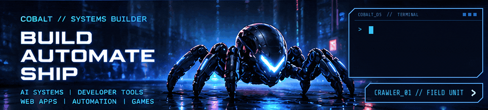
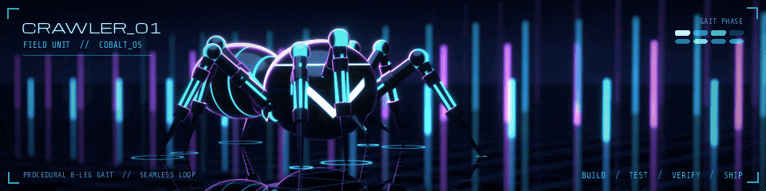

<!-- COBALT // GitHub profile README. Asset notes: assets/PROVENANCE.md -->

  <picture>
    <source media="(prefers-reduced-motion: reduce)" srcset="./assets/cobalt-hero.png" />
    
  </picture>

<h1 align="center">COBALT // SYSTEMS BUILDER</h1>

  <strong>I build AI systems, developer tools and full-stack products, and I verify them before I call them done.</strong>

  AI systems &amp; agent orchestration · Web &amp; mobile · Automation &amp; infrastructure · Audits · Game tools

  
  
  

---

### `> whoami`

I'm **Cobalt**, an independent developer. I take software from the first architectural decision through tests and deployment, both for my own open-source tools and for commercial projects.

Most of my work sits in four places: AI-assisted development and agent orchestration, web and mobile products, automation and infrastructure, and browser and performance tooling. I also build game and simulation tools.

I care about practical performance, transparent behaviour, maintainable code, and **verification before calling something done**.

### `> featured_systems`

Public repositories I build and maintain. Status and licence are listed for each one, because they differ.

**[COBALT COCKPIT](https://github.com/echelong/cobalt-cockpit)** &nbsp;TypeScript · MIT 
Mission control for Claude Code. Follow real task progress, coordinate bounded subagents, review verification gates, and replay runs from a local Run Ledger.

**[CHATSPEED 2](https://github.com/echelong/ChatSpeed-2)** &nbsp;TypeScript · MIT 
Manifest V3 Chromium extension that reduces browser rendering work in long ChatGPT, Claude.ai, Grok, Gemini and DeepSeek conversations, with a platform-specific optimizer for each. Independent project, not affiliated with or endorsed by those platforms.

**[COBALT CAPABILITIES](https://github.com/echelong/cobalt-capabilities)** &nbsp;JavaScript · MIT 
Optional companion for Cobalt Cockpit: explicit project memory through Hindsight and bounded browser evidence through Obscura. Both stay off until you configure them, and you run the services yourself.

**[EVOLVE](https://github.com/echelong/evolve)** &nbsp;JavaScript · research · source-visible 
Experimental evolutionary trading-agent laboratory for Solana market data: deterministic replay, walk-forward evolution and matched A/B benchmarking. **Research and paper simulation only.** Every monetary figure is paper P&amp;L, and the repository has no wallet keys, no signer and no transaction path.

**[SAT//RECLAIMER](https://github.com/echelong/sat-reclaimer)** &nbsp;TypeScript · MIT · release candidate 
Non-custodial web app for deliberately spending the bitcoin locked in inscription-bearing Taproot UTXOs and sweeping it to an address you choose. **Not audited**, and Bitcoin transfers are irreversible. Read the [risk disclosure](https://github.com/echelong/sat-reclaimer/blob/master/docs/RISK.md) before using it.

  <picture>
    <source media="(prefers-reduced-motion: reduce)" srcset="./assets/crawler-patrol.png" />
    
  </picture>

### `> what_i_can_build_for_you`

| Capability | Typical work |
| :--- | :--- |
| **AI systems &amp; agent orchestration** | Claude Code plugins and integrations, structured agent workflows, orchestration, evaluation and local inference. |
| **Full-stack web &amp; mobile** | React and Next.js, APIs, PostgreSQL, auth, dashboards and SaaS products; Expo and React Native apps. |
| **Automation &amp; infrastructure** | CI/CD, deployment workflows, containers and databases. |
| **Audits, performance &amp; verification** | Application reviews, browser performance work, automated tests and launch readiness. |
| **Game &amp; simulation tools** | Game prototypes, Unreal and Godot systems, and simulation tooling. |

### `> stack`

  
  
  
  
  
  
  
  
  
  
  

---

### `> establish_connection`

**Need a product built, a hard bug solved, an app made ready for launch, or a developer tool engineered?**

I'm open to well-scoped development work and interesting collaborations.

**[EMAIL COBALT](mailto:cobalt@mail.grokbot.com)** &nbsp;·&nbsp; **[PUBLIC REPOSITORIES](https://github.com/echelong?tab=repositories)** &nbsp;·&nbsp; **[X / @CobaltHere](https://x.com/CobaltHere)**

Build it. Test it. Verify it. Ship it.

CRAWLER_01 is a mascot. The animations are decorative and show no live data. <a href="./assets/PROVENANCE.md">Asset notes</a>

